<div align="center">



</div>

<div align="center">

[](https://git.io/typing-svg)

</div>

<div align="center">


</div>

## 👋 About Me

```text
Hi, I'm Abolfazl.
```

I'm a Computer Engineering student who is never satisfied with the answer "it just works." I want to know **how** it works — down to the transistor, the instruction set, and the last cache line. That curiosity pulled me from writing my first lines of C++ into computer architecture, and eventually into GPU programming, where making code fast is a puzzle you solve with parallelism, memory hierarchies, and careful measurement.

What drives me is simple: hard technical problems. I learn best by building — so instead of only reading about schedulers, interpreters, or digital design, I write them from scratch and break them until I understand every edge case. Right now I'm going deep on CUDA, high-performance computing, and research-oriented projects, and I'm enjoying every struggle that comes with it.

> "Understand the machine, then make it do things it was never asked to do."

<div align="center">


</div>

## 🛠️ Tech Stack

<div align="center">

### Languages


### GPU & Parallel Computing


### Web & Frameworks


### Tools & Platforms


</div>

<div align="center">


</div>

## 🔥 Areas of Interest

<table>
<tr>
  <td align="center" width="33%">
    <br/>
    <sub>Parallel programming, CUDA kernels, and squeezing performance out of every streaming multiprocessor.</sub>
  </td>
  <td align="center" width="33%">
    <br/>
    <sub>Machine learning systems, accelerators, and how intelligence can be computed efficiently.</sub>
  </td>
  <td align="center" width="33%">
    <br/>
    <sub>From RISC-V pipelines to cache hierarchies — understanding the machine under the code.</sub>
  </td>
</tr>
<tr>
  <td align="center">
    <br/>
    <sub>Optimization, benchmarking, and making the impossible merely slow.</sub>
  </td>
  <td align="center">
    <br/>
    <sub>Pushing computation to where the data lives — low latency, constrained devices.</sub>
  </td>
  <td align="center">
    <br/>
    <sub>Clean architecture, maintainable systems, and the craft of writing real software.</sub>
  </td>
</tr>
</table>

<div align="center">


</div>

## 📊 GitHub Statistics

<div align="center">
<table>
  <tr>
    <td>
      
    </td>
    <td>
      
    </td>
  </tr>
</table>


</div>

<div align="center">


</div>

## 🌱 Currently Learning

- ⚡ **CUDA & GPU Programming** — kernels, memory coalescing, warp-level primitives
- 🚀 **High-Performance Computing** — parallel algorithms and performance profiling
- 🧠 **AI Systems** — how modern accelerators run machine learning workloads
- 🖥️ **Advanced Computer Architecture** — pipelines, caches, and beyond

<div align="center">


</div>

## ✨ Featured Projects

<div align="center">
<table>
  <tr>
    <td width="50%">
      <a href="https://github.com/abolfazljalil2003/Basics-of-Verilog">
        
      </a>
      <br/><sub>A complete Persian Verilog course — from transistor-level modeling to FSMs, RAM, and hands-on projects, with tested examples and testbenches.</sub>
    </td>
    <td width="50%">
      <a href="https://github.com/abolfazljalil2003/RARS-for-RISC-V">
        
      </a>
      <br/><sub>A beginner-friendly RISC-V tutorial using the RARS simulator, with simple examples and installation guides.</sub>
    </td>
  </tr>
  <tr>
    <td width="50%">
      <a href="https://github.com/abolfazljalil2003/-ScriptoX">
        
      </a>
      <br/><sub>A lightweight interpreter for a simple scripting language — math operations, variables, labels, and conditional jumps.</sub>
    </td>
    <td width="50%">
      <a href="https://github.com/abolfazljalil2003/CPU_Scheduler_Lab_">
        
      </a>
      <br/><sub>Operating systems lab implementing CPU scheduling algorithms and analyzing their behavior.</sub>
    </td>
  </tr>
</table>
</div>

<div align="center">


</div>

## 🔬 Research Interests

- **GPU architecture & general-purpose computing** — how hardware design shapes what parallel algorithms can achieve
- **AI acceleration** — making machine learning inference and training faster and more efficient
- **Computer architecture** — instruction sets, memory hierarchies, and the performance frontier
- **Edge intelligence** — running demanding computation on resource-constrained devices

<div align="center">


</div>

## 📫 Connect With Me

<div align="center">

[](mailto:abolfazljalil6@gmail.com)
[](https://github.com/abolfazljalil2003)

</div>

<div align="center">


<br/>


<br/>

<sub>Thanks for visiting — let's build something fast ⚡</sub>

</div>
